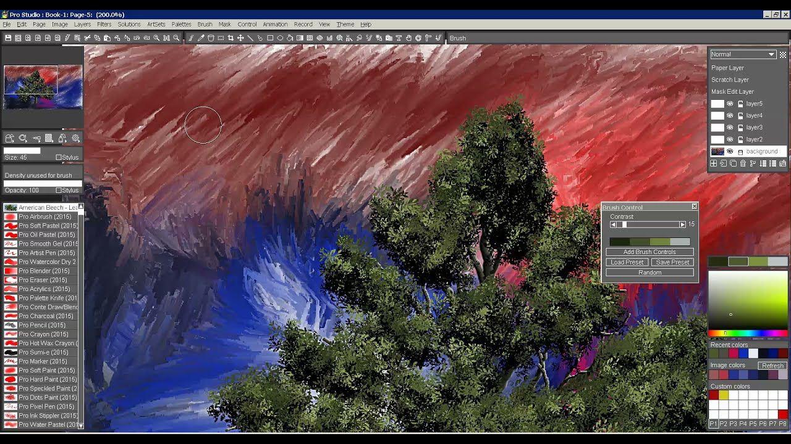
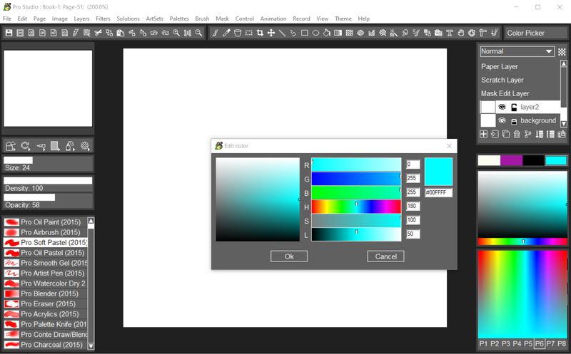

# TwistedBrush Pro Studio for Painting and Compositing

A textured stroke, a protected silhouette, and a smaller presentation image require different decisions.
TwistedBrush Pro Studio brings natural-media brushes, layers, masks, and image-processing tools into a Windows painting workspace developed by Pixarra.

[](https://twistedbrush-pro-studio.github.io/TwistedBrush-Pro-Studio/)

## Find the behavior behind a brush

Start with the mark you need: an opaque accent, a soft wash, a blended transition, or a repeated organic shape.
Pixarra TwistedBrush Pro Studio organizes its brush collection into ArtSets and includes brush editing through effects and time envelopes. See the [product overview](https://www.pixarra.com/pro_studio.html).

Use a small study to compare behavior before committing it to the illustration:

1. Draw a short stroke and a long stroke with the same brush.
2. Repeat over an empty area and over existing color.
3. Vary pen pressure while keeping the chosen color constant.
4. Change one brush control, then repeat the same marks.
5. Compare the result at the intended final viewing size.

Pixarra's [oil-brush notes](https://www.pixarra.com/premium-oils-artset.html) explain how stroke length, pressure, texture, and the paint underneath can alter a mark.
A brush that blends existing color may need a different painting approach from one that deposits a clean accent.



Keep a useful brush variation with the study that demonstrates its purpose.
Record the starting ArtSet and the controls you changed so the appearance is easier to reproduce.
Avoid judging a textured brush only from its smallest preview.

## Protect the silhouette while building surface detail

Separate background, main forms, and finishing marks when they need independent adjustments.
TwistedBrush supports layers, transparency, layer mixing modes, and masks that protect or select image regions.

A practical division of work is:

- Establish large color relationships before adding small texture.
- Keep an area protected while painting detail near its boundary.
- Check the active layer before making a broad adjustment.
- Review the edge over both a light and a dark background.

The Drawpile [handle_layers](test/data/handle_layers) fixture records layer-tree operations and properties such as opacity and visibility.
Its [openraster.txt](doc/openraster.txt) describes Drawpile-specific layer and annotation storage, offering a concrete example of why layered interchange needs checking.

For a transparent PNG exported from your painting, Python with Pillow can make two background proofs.
This example uses the documented [alpha_composite operation](https://pillow.readthedocs.io/en/stable/reference/Image.html#PIL.Image.alpha_composite):

```python
from PIL import Image

with Image.open("painting.png") as source:
    art = source.convert("RGBA")
for name, color in (("light", "#f5f5f5"), ("dark", "#202020")):
    background = Image.new("RGBA", art.size, color)
    proof = Image.alpha_composite(background, art).convert("RGB")
    proof.save(f"edge-proof-{name}.png")
```

Compare fine hairs, soft shadows, and partially transparent brush edges in the two proofs.
A visible halo may come from the painted edge or its stored color beneath transparency.
Keep the original transparent export alongside these opaque review images.

## Change canvas geometry deliberately

Adding canvas area, cropping a composition, and resampling pixels produce different results.
Decide whether the subject should retain its current pixel size before changing the document dimensions.
When space is added on one side, check where the existing artwork lands relative to the new boundary.

The supplied Drawpile resize images provide small reference cases with directly inspectable pixel dimensions:

| Geometry case | Reference images and dimensions |
| --- | --- |
| Unchanged dimensions | [same.png](test/data/image_resize/same.png), 64 × 32 |
| Narrower and wider | [smaller_width.png](test/data/image_resize/smaller_width.png), 48 × 32; [larger_width.png](test/data/image_resize/larger_width.png), 80 × 32 |
| Shorter and taller | [smaller_height.png](test/data/image_resize/smaller_height.png), 64 × 24; [larger_height.png](test/data/image_resize/larger_height.png), 64 × 40 |
| Positive offsets | [positive_x.png](test/data/image_resize/positive_x.png) and [positive_y.png](test/data/image_resize/positive_y.png), both 64 × 32 |
| Negative offsets | [negative_x.png](test/data/image_resize/negative_x.png) and [negative_y.png](test/data/image_resize/negative_y.png), both 64 × 32 |
| Out-of-bounds case | [out_of_bounds.png](test/data/image_resize/out_of_bounds.png), 64 × 32 |
| Combined changes | [everything.png](test/data/image_resize/everything.png), 114 × 20 |

These dimensions describe the reference files, rather than settings to enter into TwistedBrush.
Use the cases to distinguish a changed boundary from a changed scale.

Pixel dimensions also differ from print-resolution metadata.
The Drawpile [handle_metadata](test/data/handle_metadata) fixture changes horizontal and vertical DPI values independently.
For a print handoff, confirm the required physical size and pixel dimensions together.

## Prepare a smaller image for review

Artwork made in TwistedBrush Pro Studio may contain texture that reads well at painting size but disappears in a small preview.
Inspect the composition after reduction, paying attention to silhouette, value separation, and thin marks.

The thumbnail references cover several output shapes:

- [ratio_kept.png](test/data/image_thumbnail/ratio_kept.png) is a 256 × 58 wide preview.
- [same_aspect_ratio.png](test/data/image_thumbnail/same_aspect_ratio.png) is 128 × 128.
- [width_limit.png](test/data/image_thumbnail/width_limit.png) is 100 × 100.
- [height_limit.png](test/data/image_thumbnail/height_limit.png) is 200 × 200.
- [zero_dimension_becomes_one.png](test/data/image_thumbnail/zero_dimension_becomes_one.png) is a very shallow 4 × 1 case.

Keep a preview's aspect ratio intentional; stretching changes the shapes you painted.
For a separate review copy, ImageMagick can limit a PNG to a bounding box and create an opaque JPEG.
The [command-line options reference](https://imagemagick.org/command-line-options/) documents resizing, alpha handling, and output quality:

```powershell
magick "painting.png" -resize "1600x1200>" "painting-review.png"
magick "painting-review.png" -background white -alpha remove -alpha off -quality 92 "painting-review.jpg"
```

The greater-than modifier prevents enlargement when the input already fits inside the box.
The JPEG uses a white background, so compare it with the transparent PNG when edge appearance matters.
These commands produce presentation copies; continue painting from the editable working document.



## Keep the editable painting with its presentation copies

Pixarra TwistedBrush supports TBR, PSD, PNG, JPEG, TIFF, and other image formats.
Choose a format for its intended use, then reopen a sample in the receiving application.
A format appearing in two applications does not establish identical support for every layer or blending feature.

Keep related materials together:

- The editable painting and any source photographs.
- Brush variations and notes needed to continue the work.
- A transparent export where transparency is required.
- An opaque review copy with an intentional background.
- The requested output dimensions and relevant print instructions.

For a contrasting storage example, Drawpile's [project_basics_dump01_blank](test/data/project_basics_dump01_blank) shows an empty project database dump with schema identifiers.
It illustrates how an editable project can contain structural information beyond a flattened image.

Tracing paper can help maintain proportions, while clips can retain reusable image elements.
Use these tools to support the current composition, then inspect the final visible result before exporting.
The [Pixarra feature comparison](https://www.pixarra.com/features.html) distinguishes Pro Studio capabilities from the other studio products.

## Related Search Terms

TwistedBrush Pro Studio, TwistedBrush Pro Studio, pixarra twistedbrush pro studio, twisted brush pro studio, pixarra twistedbrush, digital-painting, painting, brushes, raster-graphics, image-editing, layers, masks, graphics-tablet, art, windows
